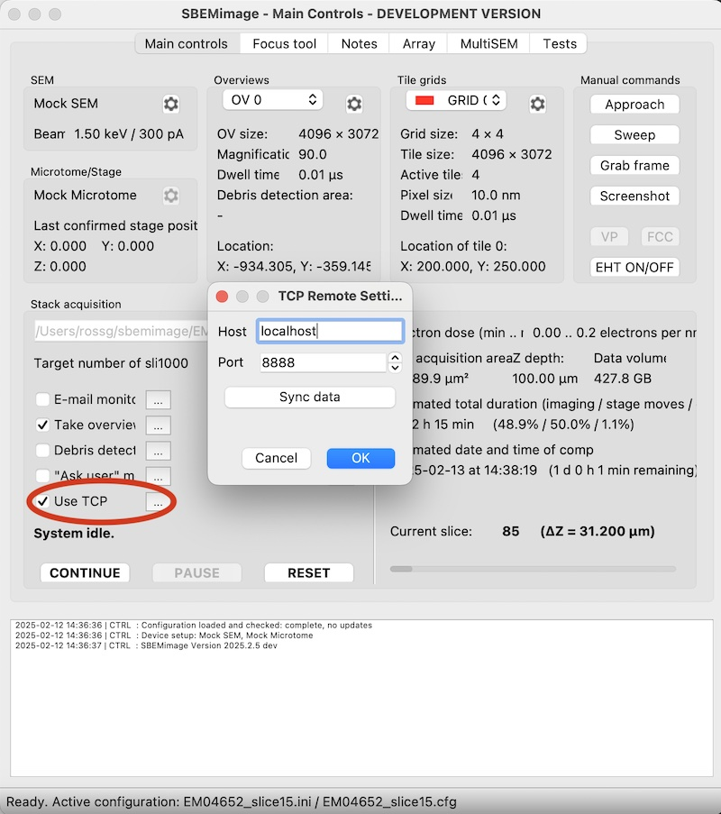

# External tools

External tools can be connected to SBEMimage via the 'Use TCP' option. When the checkbox is active, SBEMimage will send the current state to the given address and port via a TCP request at the start of every slice. The external tools can reply with commands to pause the acquisition, add and remove grids and activate and deactivate grid tiles.



An example of such a tool is the [napari-isbem](https://github.com/FrancisCrickInstitute/napari-isbem) plugin, which selects regions of interest in the overview images and lets SBEMimage image them at high resolution.

## Connection

-   SBEMimage is the TCP *client*; the external tool must run a TCP *server* at the host and port set in the TCP settings (session configuration `[acq]`: `use_tcp`, `tcp_host`, default `localhost`, and `tcp_port`, default `8888`).
-   At the start of every slice of an acquisition (the first one included, and after the cut of the previous slice), SBEMimage opens a connection, sends the state as one JSON object, and waits for the reply.
-   The reply is one JSON object. SBEMimage reads until the connection is closed or a newline (`\n`) is received, so the server must close the connection or end the reply with a newline after sending it.
-   There is no timeout: the acquisition waits until the server replies. If the connection is refused (no server running), the acquisition is paused. Other errors (a connection reset, a reply that is not valid JSON, a command without `args` or `kwargs`) stop the acquisition.
-   The state can be larger than 1024 bytes (it grows with the number of overviews): the server should read until it has a complete JSON object.

## State sent by SBEMimage

```json
{"paused": PAUSE STATE,
 "z_depth": STAGE Z DEPTH,
 "overviews": {"number_ov": NUMBER OF OVERVIEWS,
               "ov_coords": LIST OF OVERVIEW COORDS,
               "ov_dirs": LIST OF OVERVIEW DIRECTORIES},
 "slice_thickness": CURRENT SLICE THICKNESS
}
```

| Key | Type | Units / meaning |
|---|---|---|
| `paused` | bool | Currently always `true`, so do not rely on it. The state is only sent while the acquisition is running: a paused acquisition sends no requests |
| `z_depth` | float | Current stage Z position in µm (the microtome stage if used, otherwise the SEM stage) |
| `number_ov` | int | Number of overviews; overview indices are `0 .. number_ov - 1` |
| `ov_coords` | list of `[x, y]` | Top-left corner of each overview, in SEM coordinates (µm, see below) |
| `ov_dirs` | list of str | Folder in which each overview's images are saved |
| `slice_thickness` | int | Slice thickness in nm |

## Commands

Response commands must be supplied in the form:

```json
{"commands": [
    {"msg": "COMMAND 1", "args": [], "kwargs": {}},
    {"msg": "COMMAND 2", "args": [], "kwargs": {}}
]}
```

Every command must have all three keys `msg`, `args` and `kwargs`. Commands are executed in the order given, before the slice is acquired. An empty list (`{"commands": []}`) continues the acquisition unchanged.

| Command | Arguments | Effect |
|---|---|---|
| `PAUSE` | `pause_state` | `1`: pause now, without acquiring this slice; `2`: acquire and cut this slice, then pause |
| `ACTIVATE OV` / `DEACTIVATE OV` | `ov_index` | Include or exclude an overview from the acquisition |
| `SET OV INTERVAL` | `ov_index`, `interval` | Acquire the overview every `interval` slices |
| `SET SLICE THICKNESS` | `thickness` | Slice thickness in nm |
| `ADD ARRAY GRID` | `array_index`, `roi_index`, `roi_center`, `size`, `ref_center` | Add a grid covering a region of interest, or update the grid already added for `roi_index` (see below) |
| `UPDATE GRID TILES WITH MASK` | `array_index`, `roi_index`, `mask` | Activate only the grid's tiles that the mask covers (see below) |
| `ACTIVATE ARRAY GRID` / `DEACTIVATE ARRAY GRID` | `roi_index` | Include or exclude the grid(s) added for `roi_index` |
| `DELETE ALL ARRAY GRIDS` | `keep_template_grids` (optional, default `false`) | Delete all grids added for regions of interest; with `true`, those with `array_index` `null` (the ones added over TCP) are kept |

`array_index` is `null` for grids added from an overview (it is used for array tomography sections). `roi_index` is an identifier chosen by the external tool; the same value refers to the same grid in later commands.

## Coordinate conventions

SBEMimage uses these coordinate systems (see `src/CoordinateSystem.py`):

-   **Stage coordinates** (`s`): microtome or SEM stage position in µm.
-   **SEM coordinates** (`d`): position in µm in the SEM's image axes, with the same origin as the stage. X increases to the right and Y downwards, as in the acquired images. All coordinates exchanged over TCP are in SEM coordinates, except `z_depth`.

The stage calibration converts between the two (see below), so an external tool does not need to know it: positions measured in the images can be used directly.

### Image metadata

Overview and tile images are saved as OME-TIFF (`.ome.tif`, the default) with the following metadata (written for ZEISS, TFS Phenom and the mock SEM; not yet for TESCAN):

-   `PhysicalSizeX` / `PhysicalSizeY`: pixel size in µm.
-   `PositionX` / `PositionY`: the image's top-left corner in SEM coordinates (µm), computed from the stage position at acquisition through the stage calibration. The image centre is `PositionX + width * PhysicalSizeX / 2` (likewise for Y).
-   `PositionZ`: stage Z in µm, the same value as `z_depth`. The difference between consecutive slices gives the slice thickness.

### Grids from a region of interest

For `ADD ARRAY GRID`:

-   `ref_center` `[x, y]`: centre of the reference (overview) image in SEM coordinates, in µm.
-   `roi_center` `[x, y]`: centre of the region of interest relative to `ref_center`, in µm along the image axes.
-   `size` `[width, height]`: size of the region of interest in µm.

The grid centre in stage coordinates is computed as `convert_d_to_s(roi_center / scale + ref_center)`, and the grid size from `size / scale`, where `scale` is the calibration's `[scale_x, scale_y]`. With a calibrated scale of exactly 1 this is the region of interest as drawn. Other scales offset and resize the region by that factor, and a negative scale (an axis flipped by the calibration, as in the default SEM-stage calibration) mirrors the offset along that axis and gives a negative size: check the grid's position in the Viewport before acquiring.

New grids are not rotated, so they are aligned with the SEM's image axes: the overview and the grids must be acquired with the same scan rotation.

The tile settings (frame size, pixel size, overlap, dwell time, focus parameters) are copied from grid 0, so set up grid 0 with the tile settings wanted before starting the acquisition. The number of tiles is the smallest grid that covers `size` with these tiles and their overlap.

### Tile masks

For `UPDATE GRID TILES WITH MASK`, `mask` is a 2D list of 0/1 values (rows along Y, columns along X) covering the region of interest's `size`, at any resolution. SBEMimage pads it to the grid's extent, centred, and activates every tile that any non-zero mask value falls in. Tiles are numbered row by row from the top-left.

## Calibration requirements

-   **Stage calibration.** The conversion between SEM and stage coordinates uses the stage calibration `[scale_x, scale_y, rotation_x, rotation_y]` in the system configuration (`[stage]`: `microtome_calibration_params` when a microtome stage is used, else `sem_calibration_params`). It is stored per EHT (in volts, for example `{"1500": [...]}`), and is set in *Calibration > Stage calibration*. A negative scale flips that axis.
-   **Calibrate at the EHT used.** If there is no calibration for the current EHT, the nearest available one is used, and positions (image metadata, `ov_coords`, new grids) are off by the difference.
-   **Positions are recorded through the same calibration.** Image positions and grid positions are converted with the calibration valid at the time. After recalibrating, positions measured in images acquired before no longer match the stage exactly: re-acquire the overviews before adding grids from them.
-   **Pixel size.** Region sizes and positions in µm come from the image pixel size, so the SEM's magnification calibration (*Calibration > Magnification calibration*) must be correct for the frame sizes used.
-   **Scan rotation.** Grids from regions of interest have no rotation: overviews and grids need the same scan rotation (0 unless both use the same).
